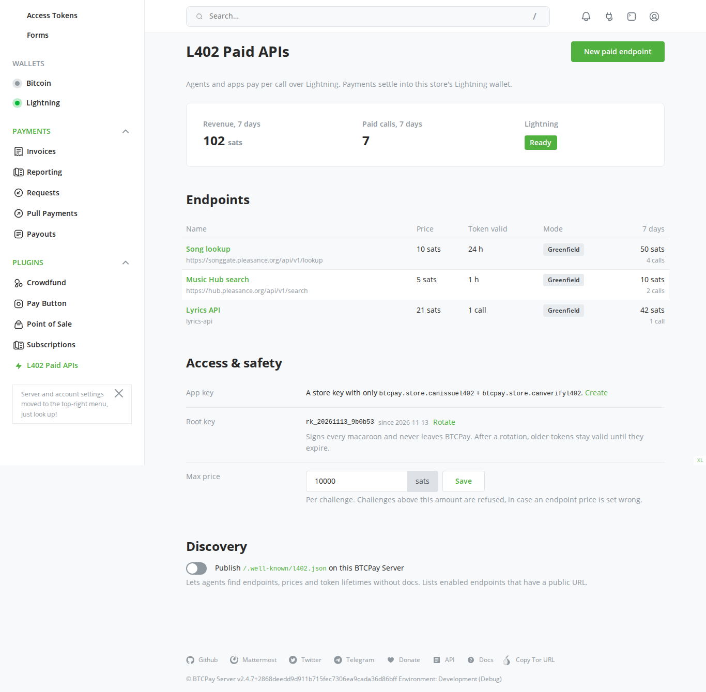

# Meterbolt – L402 paid APIs

Sell API calls to agents and apps over Lightning, straight from your own BTCPay Server.

Meterbolt adds [L402](https://docs.lightning.engineering/the-lightning-network/l402) to BTCPay Server. Your API asks BTCPay for a challenge, the client pays a Lightning invoice, and your API checks the token with BTCPay before it answers. It works with every Lightning backend BTCPay supports, and every payment is a normal BTCPay invoice, so reporting, exports and webhooks keep working.



## What you get

- **Paid endpoints per store.** Name, price in sats, token lifetime (from one call to 30 days) and an optional public URL. The price is always set in BTCPay, never by the client.
- **Two API calls for your app.** Create a challenge (macaroon + BOLT11 invoice) and verify a token. A store API key with just these two permissions is all your app needs; the macaroon root keys never leave BTCPay.
- **Safety controls.** Rotate the root key at any time (older tokens stay valid until they expire), cap the price of a single challenge, revoke single tokens, disable an endpoint.
- **Numbers without tracking.** Revenue and paid calls of the last 7 days per endpoint. Meterbolt stores no data about buyers, only tokens and invoices.
- **Discovery.** Optionally publish `/.well-known/l402.json` so agents find your endpoints, prices and token lifetimes.

Proxy mode (BTCPay forwards paid requests to your API) is planned for a later version.

## Requirements

- BTCPay Server 2.4.7 or later
- Lightning set up for the store (any backend: LND, Core Lightning, Eclair, LNbits, …)

## Setup

1. Install the plugin and open your store. **L402 Paid APIs** appears under *Plugins* in the menu.
2. Click **New paid endpoint**, give it a name, a price and a token lifetime.
3. Under **Access & safety**, click **Create** next to *App key*. BTCPay asks you to confirm a key with only `btcpay.store.canissuel402` and `btcpay.store.canverifyl402` for this store. Give that key to your API.
4. Open the endpoint and follow the **Integrate** tab.

## How your API uses it

When a request arrives without a valid token, ask BTCPay for a challenge:

```http
POST /api/v1/stores/{storeId}/l402/endpoints/{slug}/challenges
Authorization: token <app key>
```

```json
{
  "macaroon": "AgJCAAD…",
  "invoice": "lnbc100n1…",
  "paymentHash": "d706c3ca…",
  "invoiceId": "5GPR8Wdh…",
  "amountSats": 10,
  "invoiceExpiresAt": 1794590217,
  "expiresAt": 1794676017,
  "wwwAuthenticate": "L402 macaroon=\"AgJCAAD…\", invoice=\"lnbc100n1…\""
}
```

Answer the client with `402 Payment Required` and the `WWW-Authenticate` value. The client pays the invoice and retries with `Authorization: L402 <macaroon>:<preimage>`. Pass that value to BTCPay:

```http
POST /api/v1/stores/{storeId}/l402/verify
Authorization: token <app key>

{ "authorization": "L402 AgJCAAD…:fdd3e006…", "endpoint": "song-lookup" }
```

```json
{ "valid": true, "endpoint": "song-lookup", "paymentHash": "d706c3ca…", "expiresAt": 1794676017, "singleUse": false, "uses": 1 }
```

Rejected tokens return `{ "valid": false, "reason": "…" }` with one of `malformed`, `unknown-token`, `invalid-signature`, `wrong-endpoint`, `unknown-caveat`, `expired`, `invalid-preimage`, `revoked`, `endpoint-disabled`, `not-paid`, `already-used`. Each successful verification counts as one paid call. Both calls are documented in your server's API docs (`/docs`).

Verification checks the macaroon signature, its caveats (endpoint and expiry), that the SHA-256 of the preimage equals the payment hash, and that the BTCPay invoice is settled. Macaroons use the same format as [Aperture](https://github.com/lightninglabs/aperture), so existing L402 clients work.

## Development

See [AGENTS.md](AGENTS.md) for building, testing and running a local BTCPay instance. No local .NET install is needed; everything runs in Docker.

## License

MIT
